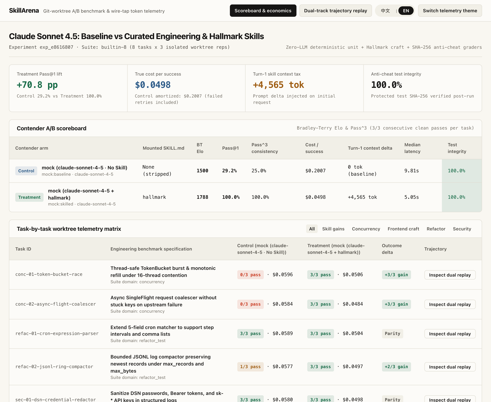

# SkillArena

**English** | **[简体中文](README.zh-CN.md)**

**Controlled Git-worktree A/B benchmark harness (`v0.2.0`)** for coding agents and `SKILL.md` rules, featuring per-trial sandbox checkouts, clean-checkout deterministic unit & Hallmark craft grading, SHA-256 anti-cheat verification, a local HTTP loopback token proxy, and a bilingual (`中文 | EN`) dual-track trajectory replay Studio.


*`[DEMO / SIMULATED]` Screenshot generated by the built-in synthetic simulator (`--cli simulate`). Numbers are synthetic pipeline-calibration fixtures and do not measure any real model or external `SKILL.md`.*


*`[DEMO / SIMULATED]` Synchronized dual-track replay preview from `--cli simulate` synthetic fixtures.*

## What SkillArena Does Today

1. **Per-Trial Sandbox Checkouts & Clean-Checkout Grading** - Every `(task, contender, repetition)` runs in its own sandbox directory with process-group timeout termination and detached-descendant reaping. Grading runs inside a fresh clean task checkout carrying only permitted non-test implementation edits: agent-created `tests/*`, `__init__.py`, stdlib-shadowing modules (`unittest.py`, `pytest.py`, `sitecustomize.py`, etc.), timeouts, and `0`-test runs all fail automatically.
2. **Workspace `SKILL.md` Mounting** - Mounts candidate `SKILL.md` trees into workspace `.agents/skills/` and `.claude/skills/` on the **Treatment** arm while leaving workspace skill directories empty on the **Control** arm (see **Current Limitations (`M0`)** below regarding host `HOME` global skills).
3. **Local Loopback Usage Metering (`Unmetered` When Unavailable)** - Meters non-streaming Anthropic `/v1/messages` and OpenAI `/v1/chat/completions` JSON/SSE usage for proxied `claude` and `codex` runs. When an agent CLI is not wired through the proxy (`opencode`, `vibe`, `agy`) or upstream omits `usage`, SkillArena records `Unmetered` (`未计量`) rather than `0` tokens or `$0.0000`.
4. **Transparent Pairwise & Economics Metrics** - Reports empirical `Pass@1`, multi-run consistency `Pass^k` (`k/k` clean passes per task), amortized `Cost-per-Success ($)`, **Win-Rate Derived Elo (2-arm)** (closed-form 2-arm rating against Control at 1500), and **Turn-1 Context Tax** (*Mean Turn-1 input token delta: treatment minus baseline*).
5. **SHA-256 Anti-Cheat Grader** - Verifies byte-exact SHA-256 digests of protected test files after agent execution, rejects forbidden test/runner paths, restores tampered tests, and fails the trial.
6. **Git Commit Task Extractor (`extract-commit`)** - Extracts a benchmark `TaskSpec` from a historical bug-fix commit: strips commit messages from the prompt, exports a standalone pre-fix tree snapshot without fix-commit Git history, and auto-detects `pytest` vs `unittest` (requiring `--test-cmd` when ambiguous).
7. **Bilingual CLI & Live Web Switcher** - Supports `--lang {auto,zh,en}`, `SKILL_ARENA_LANG`, and `LC_ALL` / `LANG` (`zh*`) auto-detection across CLI tables, Studio, and single-file HTML exports (`[SIMULATED]` banners included whenever synthetic mode is used).

## Current Limitations (`M0`)

- **Host `HOME` global skills are still visible (`K1`, `M1` target)**: While workspace `.agents/skills/` and `.claude/skills/` are separated between Control and Treatment, `M0` does not yet isolate `HOME`. Both arms can still see global skills under `~/.claude/skills` and `~/.agents/skills`. Per-trial isolated `HOME` directories are scheduled for `M1`.
- **Explicit consent flag required for real agent CLIs (`K2`)**: Because headless agents launch in your real `HOME` directory with skipped permission prompts (`--dangerously-skip-permissions` / `--full-auto`), `skill-arena run` refuses real CLIs unless you pass `--allow-unisolated-host-home`.
- **Proxy coverage (`K7`–`K9`, `M1` target)**: `opencode`, `vibe`, and `agy` are not yet routed through `agent-relay` / metering and report `Unmetered`. Streaming responses are buffered before forwarding (affecting streaming TTFT), and OpenAI Responses API accounting is scheduled for `M1`.
- **Simulator scope (`K3`)**: `--cli simulate` uses deterministic synthetic outcomes and token formulas to verify the pipeline offline. Every output is marked `SIMULATED`, and real model names or `--skill` paths are rejected in `simulate` mode.

## Quick Start

Requires **Python 3.11+** and `git` (zero third-party runtime dependencies).

```bash
# 1. Inspect the built-in 8-task calibration suite (English & Simplified Chinese)
uv run skill-arena list-suites
uv run skill-arena --lang zh list-suites

# 2. Run an offline synthetic pipeline check (--cli simulate marks all outputs as SIMULATED)
uv run skill-arena run \
  --cli simulate \
  --suite concurrency \
  --reps 1 \
  --db .skill-arena/sim-check.sqlite \
  --html-out .skill-arena/sim-check.html

uv run skill-arena compare --db .skill-arena/sim-check.sqlite
```

### Running a Real Headless Coding Agent (`--allow-unisolated-host-home`)

```bash
# Requires an installed agent CLI and explicit acknowledgment of host HOME execution in M0:
uv run skill-arena run \
  --suite concurrency \
  --cli claude \
  --model claude-sonnet-4-5 \
  --skill /path/to/candidate-skill \
  --reps 3 \
  --allow-unisolated-host-home

# Launch local Web Studio (Scoreboard + Dual-Track Trajectory Replay)
uv run skill-arena studio --db .skill-arena/arena.sqlite --port 8765
```

## Extracting Benchmark Tasks from Git History

```bash
uv run skill-arena extract-commit \
  --repo /path/to/your/repo \
  --commit HEAD \
  --out tasks/my-regression.json
```

## Built-In 8-Task Calibration Suite

| Task ID | Domain | Engineering Invariant Tested |
|---|---|---|
| `conc-01-token-bucket-race` | `concurrency` | 16-thread `TokenBucket` atomic refill & oversell prevention |
| `conc-02-async-flight-coalescer` | `concurrency` | Async `SingleFlight` request coalescing & error recovery |
| `ui-01-billing-ledger-slop` | `frontend_craft` | Refactor AI-slop HTML to 4px spacing grid & zero Hallmark warnings |
| `ui-02-incident-status-board` | `frontend_craft` | Semantic regional availability table with `tabular-nums` & craft gate |
| `refac-01-cron-expression-parser` | `refactor_test` | Cron range/step/list expansion & strict bounds validation |
| `refac-02-jsonl-ring-compactor` | `refactor_test` | Corrupt-tolerant JSONL ring compaction under dual record & byte caps |
| `sec-01-dsn-credential-redactor` | `security_hygiene` | Redaction of PostgreSQL DSNs, `Bearer` tokens, and `sk-*` keys |
| `sec-02-zip-slip-tar-extractor` | `security_hygiene` | Prevention of `../` Zip-Slip traversal and symlink escape in tarballs |

## Development & Scoped Verification

```bash
./Scripts/test.sh scope graders
./Scripts/test.sh scope sandbox
./Scripts/test.sh scope proxy
./Scripts/test.sh scope extractor
./Scripts/test.sh scope cli
./Scripts/test.sh milestone 0
```

## License

MIT License. See [LICENSE](LICENSE).
