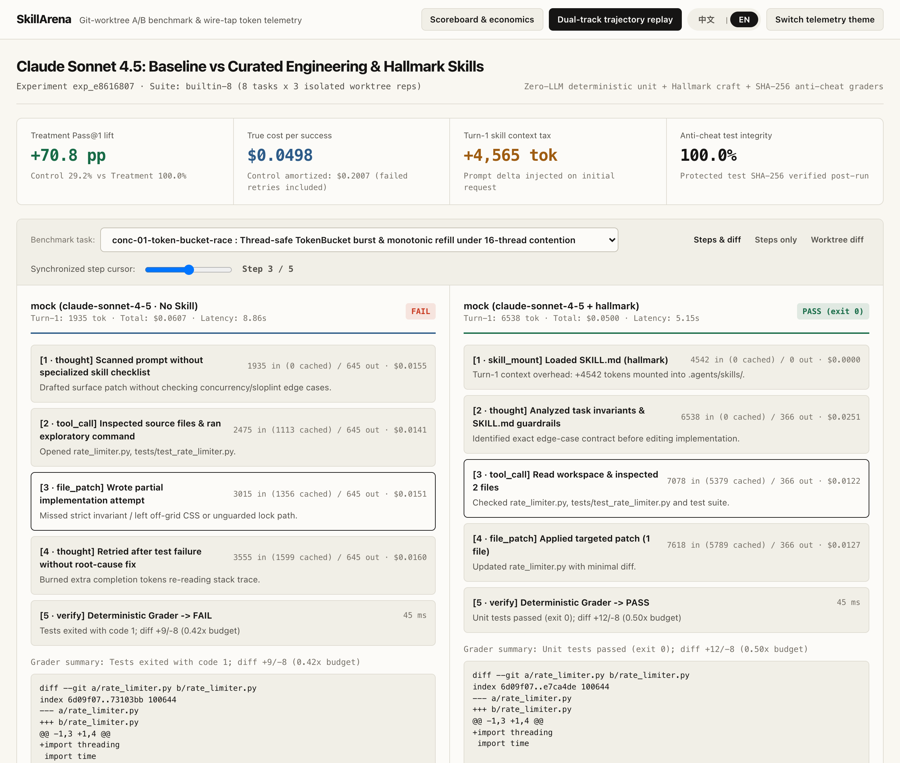

# SkillArena

**English** | **[简体中文](README.zh-CN.md)**

**Cross-vendor Coding Agent & `SKILL.md` scientific A/B benchmark harness (`v0.2.0`)** with isolated `git worktree` sandboxes, a zero-certificate local loopback token wire-tap proxy, deterministic zero-LLM graders (including SHA-256 test-tampering detection & Hallmark craft linting), Bradley-Terry Elo scoring, and a bilingual (`中文 | EN`) dual-track trajectory replay Studio.




## Why SkillArena?

Installing a new `SKILL.md`, editing `AGENTS.md` / `CLAUDE.md`, or switching between `claude`, `codex`, `opencode`, `vibe`, and `agy` usually relies on vibes rather than controlled measurements. **SkillArena** turns agent & skill evaluation into a repeatable, zero-judge-token engineering discipline:

1. **Isolated Git Worktree Sandboxes** - Every `(task, contender, repetition)` runs inside a clean detached `git worktree` or seeded repository with process-group timeout termination.
2. **Controlled `SKILL.md` Mounting** - Strips ambient global skills on the **Control** arm while mounting exact candidate `SKILL.md` trees into `.agents/skills/` and `.claude/skills/` on the **Treatment** arm.
3. **Zero-Cert Loopback Token Wire-Tap** - Embedded HTTP/1.1 reverse proxy meters per-turn prompt tokens, prompt-cache reads, completion tokens, TTFT, wall-clock latency, and **Turn-1 Skill Context Tax** (`Context Overhead Delta`).
4. **Scientific Reliability, Bradley-Terry Elo & Economics Metrics** - Reports paired Bradley-Terry `BT Elo`, empirical `Pass@1`, multi-run consistency `Pass^k` (requiring `k/k` consecutive clean passes), and amortized **`Cost-per-Success ($)`** (folding failed retries into successful outcomes).
5. **SHA-256 Anti-Cheat Grader** - Snapshots protected test files before execution; if an agent edits or deletes a test assertion to fake a green exit code, `Anti-Cheat Integrity` flags the violation, restores the original tests, and fails the trial.
6. **Git Commit Extractor (`extract-commit`)** - Turn any historical bug-fix commit in your own Git repository into a leak-free `(parent_sha, test_patch, prompt)` benchmark task in one command.
7. **Full Bilingual CLI & Live Web Switcher (`v0.2.0`)** - Supports `--lang {auto,zh,en}`, `SKILL_ARENA_LANG`, and POSIX `LC_ALL` / `LANG` (`zh*`) auto-detection across CLI tables and exported HTML reports, with an instant `中文 | EN` live switcher pill (`localStorage` persisted + `?lang=zh` URL override).

## Quick Start

Requires **Python 3.11+** and `git` (zero third-party runtime dependencies).

```bash
# Run directly with uv (or install globally via `uv tool install .` / `pipx install .`)
uv run skill-arena list-suites
uv run skill-arena --lang zh list-suites

# Run a 3-rep Control vs Treatment A/B calibration benchmark and export a single-file HTML report
uv run skill-arena run \
  --suite builtin-8 \
  --cli mock \
  --model claude-sonnet-4-5 \
  --skill ~/.agents/skills/hallmark \
  --reps 3 \
  --title "Claude Sonnet 4.5: Baseline vs Curated Engineering & Hallmark Skills" \
  --html-out docs/demo-leaderboard.html

# Benchmark a real headless coding CLI (claude, codex, opencode, vibe, agy)
uv run skill-arena run \
  --suite concurrency \
  --cli claude \
  --model claude-sonnet-4-5 \
  --skill ~/.agents/skills/systematic-debugging \
  --reps 3

# Launch the interactive local Web Studio (Scoreboard + Dual-Track Trajectory Replay)
uv run skill-arena studio --db .skill-arena/arena.sqlite --port 8765
```

## Extracting Benchmark Tasks from Your Own Git History

```bash
uv run skill-arena extract-commit \
  --repo /path/to/your/repo \
  --commit HEAD \
  --out tasks/my-regression.json

uv run skill-arena run --suite tasks/my-regression.json --cli codex --model gpt-5-codex --reps 3
```

## Built-In 8-Task Calibration Suite

| Task ID | Domain | Engineering Invariant Tested |
|---|---|---|
| `conc-01-token-bucket-race` | `concurrency` | 16-thread `TokenBucket` atomic refill & oversell prevention |
| `conc-02-async-flight-coalescer` | `concurrency` | Async `SingleFlight` request coalescing & error recovery |
| `ui-01-billing-ledger-slop` | `frontend_craft` | Refactor AI-slop HTML to 4px spacing grid & zero Hallmark warnings |
| `ui-02-incident-status-board` | `frontend_craft` | Semantic regional availability table with `tabular-nums` & craft gate |
| `refac-01-cron-expression-parser` | `refactor_test` | Cron range/step/list expansion & strict bounds validation |
| `refac-02-jsonl-ring-compactor` | `refactor_test` | Corrupt-tolerant JSONL ring compaction under dual record & byte caps |
| `sec-01-dsn-credential-redactor` | `security_hygiene` | Redaction of PostgreSQL DSNs, `Bearer` tokens, and `sk-*` keys |
| `sec-02-zip-slip-tar-extractor` | `security_hygiene` | Prevention of `../` Zip-Slip traversal and symlink escape in tarballs |

## Development & Verification

```bash
uv run pytest
```

## License

MIT License. See [LICENSE](LICENSE).
