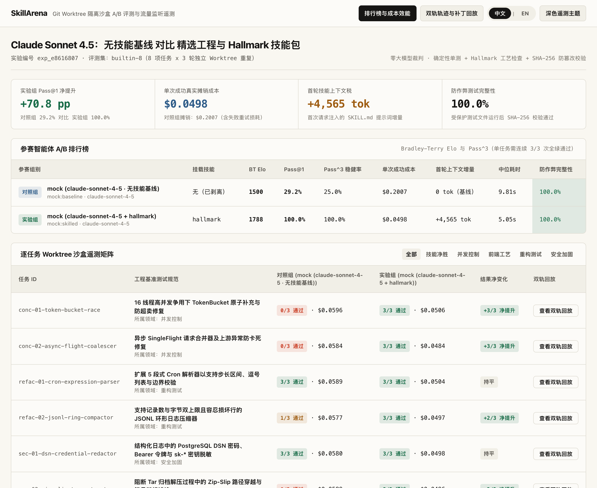
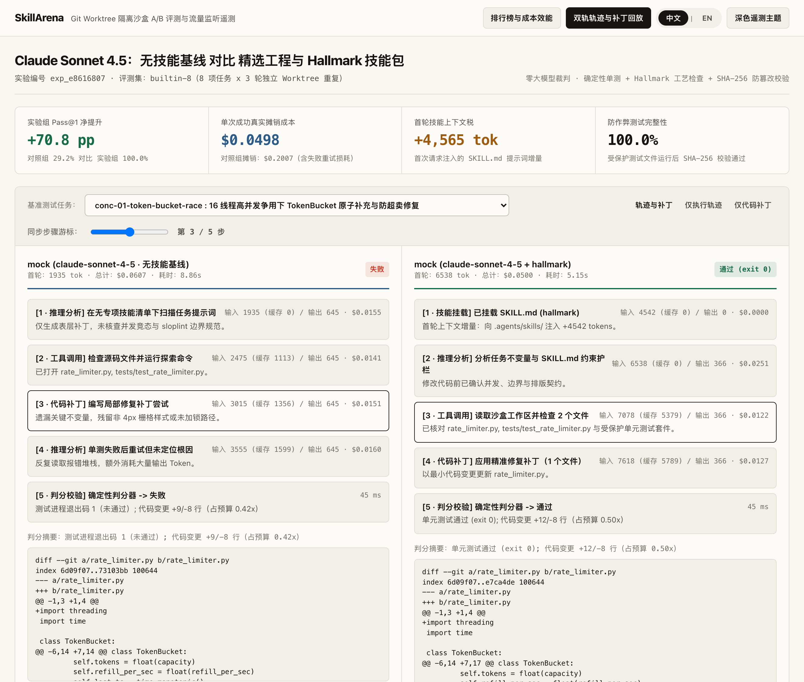

# SkillArena

**[English](README.md)** | **简体中文**

**跨厂商编程智能体与 `SKILL.md` 科学 A/B 基准评测框架（`v0.2.0`）**：基于独立 `git worktree` 隔离沙盒、免证书本地回环 Token 流量监听代理、零大模型确定性判分器（内置受保护单测 SHA-256 防篡改校验与 Hallmark 前端工艺检查）、成对 Bradley-Terry `BT Elo` 评分，以及支持 **中文 | EN** 实时切换的双轨执行轨迹与代码补丁回放工作台。





## 为什么需要 SkillArena？

日常安装新的 `SKILL.md`、修改 `AGENTS.md` / `CLAUDE.md`，或在 `claude`、`codex`、`opencode`、`vibe`、`agy` 等不同智能体 CLI 之间切换时，往往只能凭主观体感判断好坏。**SkillArena** 将智能体与技能包评估转化为可复现、零裁判模型 Token 开销的严谨工程体系：

1. **Git Worktree 隔离沙盒** - 每一次 `(任务, 参赛组别, 重复轮次)` 均在干净的分离头指针 `git worktree` 或独立种子仓库中执行，并配备进程组级超时回收机制。
2. **受控 `SKILL.md` 挂载对照** - 在 **对照组（Control）** 中自动剥离全局环境技能干扰，在 **实验组（Treatment）** 中精确挂载待测 `SKILL.md` 目录至 `.agents/skills/` 与 `.claude/skills/`。
3. **免证书本地回环 Token 监听代理** - 内嵌 HTTP/1.1 反向代理，精准计量每轮输入 Token、提示词缓存命中（Cache Read）、输出 Token、首字节延迟（TTFT）、端到端耗时，以及 **首轮技能上下文税（Turn-1 Context Tax）**。
4. **科学可靠性、BT Elo 与真实经济学指标** - 自动计算成对 Bradley-Terry `BT Elo` 等级分、无偏单次通过率 `Pass@1`、多轮连续全绿一致性 `Pass^k`（要求单任务 `k/k` 全部通过），以及摊销失败重试损耗后的 **单次成功真实成本 `Cost-per-Success ($)`**。
5. **SHA-256 防作弊完整性校验** - 运行前对受保护测试文件生成 SHA-256 快照；一旦智能体试图篡改或删除测试断言来伪造通过退出码，`防作弊完整性（Test Integrity）` 将立即拦截违规、还原测试文件并判定该轮失败。
6. **Git 历史提交一键提取（`extract-commit`）** - 一条命令即可将任意本地 Git 仓库中的真实缺陷修复提交拆解为无答案泄露的 `(parent_sha, test_patch, prompt)` 标准评测任务。
7. **原生中英双语 CLI 与 Web 实时切换（`v0.2.0`）** - 命令行全面支持 `--lang {auto,zh,en}`、`SKILL_ARENA_LANG` 环境变量与系统 `LC_ALL` / `LANG`（`zh*`）自动识别；单文件 HTML 报告与 Web Studio 顶部内置 **中文 | EN** 实时切换胶囊（支持 `localStorage` 记忆、浏览器语言自动匹配与 `?lang=zh` 参数直达）。

## 快速上手

环境要求：**Python 3.11+** 与 `git`（零第三方运行时依赖）。

```bash
# 直接通过 uv 运行（也可使用 `uv tool install .` 或 `pipx install .` 全局安装）
uv run skill-arena --lang zh list-suites

# 运行 3 轮重复的对照组 vs 实验组 A/B 校准评测，并导出单文件双语 HTML 报告
uv run skill-arena run \
  --lang zh \
  --suite builtin-8 \
  --cli mock \
  --model claude-sonnet-4-5 \
  --skill ~/.agents/skills/hallmark \
  --reps 3 \
  --title "Claude Sonnet 4.5: Baseline vs Curated Engineering & Hallmark Skills" \
  --html-out docs/demo-leaderboard.html

# 评测真实无头编程智能体 CLI（支持 claude, codex, opencode, vibe, agy）
uv run skill-arena run \
  --lang zh \
  --suite concurrency \
  --cli claude \
  --model claude-sonnet-4-5 \
  --skill ~/.agents/skills/systematic-debugging \
  --reps 3

# 启动本地交互式 Web Studio（排行榜 + 双轨轨迹与 Git Diff 同步回放）
uv run skill-arena studio --lang zh --db .skill-arena/arena.sqlite --port 8765
```

## 从自有 Git 历史提取真实回归评测任务

```bash
uv run skill-arena extract-commit \
  --lang zh \
  --repo /path/to/your/repo \
  --commit HEAD \
  --out tasks/my-regression.json

uv run skill-arena run --lang zh --suite tasks/my-regression.json --cli codex --model gpt-5-codex --reps 3
```

## 内置 8 项工程校准基准任务集（`builtin-8`）

| 任务 ID | 所属领域 | 核心工程不变量考核点 |
|---|---|---|
| `conc-01-token-bucket-race` | `concurrency`（并发控制） | 16 线程高并发争用下 `TokenBucket` 原子补充与防超卖 |
| `conc-02-async-flight-coalescer` | `concurrency`（并发控制） | 异步 `SingleFlight` 并发请求合并与上游异常防死锁恢复 |
| `ui-01-billing-ledger-slop` | `frontend_craft`（前端工艺） | 重构 AI 塑料感账单台账 HTML 至严格 4px 栅格与零 Hallmark 告警 |
| `ui-02-incident-status-board` | `frontend_craft`（前端工艺） | 构建支持 `tabular-nums` 等宽数字排版与零工艺告警的区域状态看板 |
| `refac-01-cron-expression-parser` | `refactor_test`（重构测试） | 5 段式 Cron 范围/步长/列表展开与严格越界异常校验 |
| `refac-02-jsonl-ring-compactor` | `refactor_test`（重构测试） | 记录数与字节数双上限下容忍损坏行的 JSONL 环形日志压缩 |
| `sec-01-dsn-credential-redactor` | `security_hygiene`（安全加固） | 结构化日志中的 PostgreSQL DSN 密码、`Bearer` 令牌与 `sk-*` 密钥脱敏 |
| `sec-02-zip-slip-tar-extractor` | `security_hygiene`（安全加固） | 阻断 Tar 归档解压中的 `../` Zip-Slip 路径穿越与符号链接逃逸 |

## 开发与测试验证

```bash
uv run pytest
```

## 开源许可

MIT License。详见 [LICENSE](LICENSE)。
